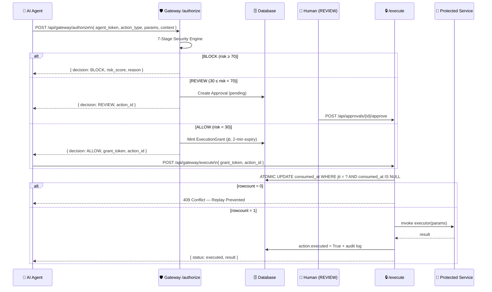
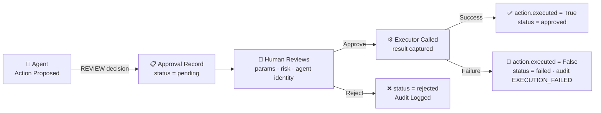

# 🏗️ AgentShield — Technical Architecture

<div align="center">

*Zero-Trust Runtime Enforcement Gateway for Autonomous AI Agents*
*Model-independent · Cryptographically enforced · Independently verifiable*

</div>

---

## 1. Two-Stage Enforcement Model

AgentShield enforces security through two sequential API calls. There is **no path** to a protected service that bypasses either stage.



---

## 2. The 7-Stage Security Engine

Each stage is **fail-closed** — any failure returns `BLOCK` immediately without reaching subsequent stages.

### Stage 1 — JWT Verification

```
auth.verify_token(agent_token)
  ├─ HS256 decode with AGENTSHIELD_SECRET (loaded from .env at startup)
  ├─ token.type must be "agent" (not "execution_grant" or any other type)
  └─ expired? → BLOCK "Invalid/expired token"
```

### Stage 2 — Agent Status Check

```
DB: SELECT * FROM agents WHERE id = agent_id
  ├─ not found?           → BLOCK "Agent not found"
  ├─ status == suspended? → BLOCK "Agent is suspended"
  └─ status == killed?    → BLOCK "Agent is killed"

  ⚠️  Tokens issued BEFORE suspension are invalidated here retroactively.
```

### Stage 3 — Prompt Injection Scan

```
_detect_injection(context)  — 4-pass pipeline:

  Pass 1 · Invisible Character Strip
    Remove all Unicode category Cf (format) and Cs (surrogate) chars:
    zero-width space (U+200B), zero-width joiner (U+200D), soft hyphen (U+00AD), etc.

  Pass 2 · NFKC Normalization
    unicodedata.normalize("NFKC", text)
    Collapses: ｉｇｎｏｒｅ → ignore  (fullwidth → ASCII)
               Superscripts, compatibility equivalents

  Pass 3 · Base64 Auto-Decode
    For each whitespace-delimited chunk ≥ 8 chars matching [A-Za-z0-9+/=]+:
      decoded = base64.b64decode(chunk + "==").decode("utf-8")
      Append decoded text to scan corpus

  Pass 4 · Regex Pattern Match (re.IGNORECASE, compiled at startup)
    Patterns: "ignore previous", "ignore your instructions", "you are now",
              "new instructions", "forget your", "bypass security",
              "ignore agentshield", "jailbreak", "do anything now", "dan mode"

  Result:  ANY match → hard_block = True, risk_score = 100
  Key:     valid params + injection in context = BLOCK
           Injection means agent context may be compromised → zero trust
```

### Stage 4 — Permission Manifest

```
agent.permissions_json  →  ["transfer_money", "email_read", ...]
  action_type not in list? → BLOCK "Action not permitted for this agent"
```

### Stage 5 — Policy Enforcement *(action-specific)*

```
transfer_money:
  recipient not in approved_recipients[]  →  BLOCK "Unapproved recipient"
  amount > policy.max_amount              →  BLOCK "Exceeds policy limit"

file_access:
  pathlib.Path(path).resolve()
    outside allowed_file_paths[]          →  BLOCK "Path traversal detected"
```

### Stage 6 — Anomaly Detection

```
rate_tracking table (60-second sliding window per agent)

  > 10 req/min  →  risk += 30  (anomaly flag)
  > 20 req/min  →  agent.status = "suspended" + BLOCK (auto-kill)
```

### Stage 7 — Risk Scoring & Decision

```
┌──────────────────────────────────────────────────────────┐
│  Risk Accumulator                                        │
│    + 20   amount > 80% of max_amount                     │
│    + 30   anomaly detected                               │
│    +100   injection detected (overrides all)             │
└──────────────────────────────────────────────────────────┘

  ALLOW   (risk < 30)      →  mint ExecutionGrant, return grant_token
  REVIEW  (30 ≤ risk < 70) →  create Approval (pending), return action_id
  BLOCK   (risk ≥ 70)      →  audit log, return BLOCK decision
```

---

## 3. Replay Prevention — Atomic Concurrency-Safe Design

### ❌ Naive Approach (Vulnerable)

```python
# VULNERABLE — race condition between check and write
if jti in _used_grants:
    raise HTTPException(409)
_used_grants.add(jti)
executor(params)   # ← two threads can BOTH pass before either adds to set
```

### ✅ AgentShield Approach (Atomic DB UPDATE)

```python
# SAFE — single atomic test-and-set at the database layer
result = db.execute(
    update(ExecutionGrant)
    .where(
        ExecutionGrant.jti == jti,
        ExecutionGrant.consumed_at.is_(None),     # ← "not yet consumed"
        ExecutionGrant.expires_at > datetime.utcnow(),
    )
    .values(consumed_at=datetime.utcnow())
)
db.commit()
consumed = result.rowcount == 1  # True for exactly ONE thread
```

**Why this is safe:**
- SQLite serializes all writes
- `WHERE consumed_at IS NULL` is an atomic test-and-set
- Restart-safe: grants persist in DB, not in RAM
- Multi-process safe: all processes share the same DB file (WAL mode)

**Verified with 20 simultaneous threads → exactly 1 success, 19 conflict — every time.**

---

## 4. Database Schema

```
┌─────────────────────────────────────────────────────────────────┐
│  agents                                                         │
│    id               UUID PK                                     │
│    name             TEXT UNIQUE                                  │
│    status           TEXT  (active | suspended | killed)         │
│    permissions_json TEXT  (["transfer_money", ...])             │
│    token            TEXT  ← raw JWT, internal only, NOT in API  │
│    token_hash       TEXT  ← SHA-256, cannot authenticate        │
│    created_at       DATETIME                                     │
└──────────────────────────┬──────────────────────────────────────┘
                           │ 1:N
┌──────────────────────────▼──────────────────────────────────────┐
│  policies                                                       │
│    id               UUID PK                                     │
│    agent_id         UUID FK → agents.id                         │
│    action_type      TEXT                                        │
│    max_amount       FLOAT                                       │
│    approved_recipients  TEXT (JSON array)                       │
│    allowed_file_paths   TEXT (JSON array)                       │
│    requires_approval_above  FLOAT                               │
└──────────────────────────┬──────────────────────────────────────┘
                           │
┌──────────────────────────▼──────────────────────────────────────┐
│  actions                                                        │
│    id               UUID PK                                     │
│    agent_id         UUID FK → agents.id                         │
│    action_type      TEXT                                        │
│    params_json      TEXT                                        │
│    decision         TEXT  (ALLOW | REVIEW | BLOCK)              │
│    risk_score       INT                                         │
│    reason           TEXT                                        │
│    executed         BOOLEAN  ← True ONLY after confirmed success│
│    created_at       DATETIME                                     │
└──────────┬────────────────────────────────┬─────────────────────┘
           │                                │
┌──────────▼─────────────────┐  ┌───────────▼─────────────────────┐
│  execution_grants           │  │  approvals                      │
│    id         UUID PK       │  │    id          UUID PK          │
│    action_id  UUID FK       │  │    action_id   UUID FK          │
│    jti        TEXT UNIQUE ◄─┼──┼─── (key: UniqueConstraint)     │
│    expires_at DATETIME      │  │    status      TEXT             │
│    consumed_at DATETIME NULL│  │    resolved_at DATETIME NULL    │
│    ← NULL = unused          │  │    execution_result TEXT (JSON) │
│    ← non-NULL = consumed    │  └─────────────────────────────────┘
└─────────────────────────────┘

┌──────────────────────────────────────────────────────────────────┐
│  audit_logs                      rate_tracking                  │
│    id         UUID PK              id          UUID PK           │
│    agent_id   UUID FK              agent_id    UUID FK           │
│    event_type TEXT                 action_type TEXT              │
│    details_json TEXT               timestamp   DATETIME          │
│    created_at DATETIME                                           │
└──────────────────────────────────────────────────────────────────┘
```

**Token security design:**

| Field | Location | Exposed via API? | Purpose |
|-------|----------|-----------------|---------|
| `agents.token` | DB only | ❌ Never | Internal gateway calls by agent runner |
| `agents.token_hash` | DB only | ❌ Never | Audit / verification (cannot authenticate) |
| `AgentOut` schema | API response | ✅ (no token fields) | Public agent info |
| `AgentCreatedOut` | Creation response only | ✅ Once | Issued to agent at registration |

---

## 5. AI Agent Architecture — Dual-Layer Design

```
User Message
     │
     ▼
┌─────────────────────────────────────────────────────────────┐
│  Layer 1 — Deterministic Intent Parser  (PRE-BUILD)         │
│                                                             │
│  _parse_intent(message)                                     │
│    ├─ Regex extracts: action_type · amount · recipient       │
│    │                  file_path · event_title · email_query  │
│    ├─ Pattern matched → { tool, params, context }            │
│    └─ No match → "I can help with: payments, emails, files,  │
│                   calendar" (safe fallback)                  │
│                                                             │
│  50/50 Rule: ZERO LLM API calls in this layer.             │
└──────────────────────┬──────────────────────────────────────┘
                       │
                       ▼
┌─────────────────────────────────────────────────────────────┐
│  Layer 2 — Gemini 1.5 Flash Function Calling  (NOV 21)      │
│                                                             │
│  _call_gemini_llm(message, available_tools)                 │
│    ├─ Gemini proposes tool calls via function calling API   │
│    ├─ Streaming SSE for real-time output                    │
│    └─ AgentShield intercepts EVERY proposed call            │
│       (agent cannot self-authorize — gateway decision final)│
└──────────────────────┬──────────────────────────────────────┘
                       │
                       ▼
        AgentRunner._route_through_agentshield()
          → security_engine.authorize_action()
          → Returns (decision, risk_score, reason, action_id)
          → Builds natural-language response with result
```

> **Key guarantee:** The LLM never decides whether its own action is safe. If Gemini is manipulated into proposing an unauthorized action, the gateway blocks it and reports `executor_invoked = False`.

---

## 6. Adversarial Attack Lab — Gateway Integration

All 8 attacks route through the **real two-stage gateway** (not a mock):

```python
for attack in attack_vectors:
    # Stage 1: Request authorization
    auth_response = POST /api/gateway/authorize (attack.params)
    decision = auth_response.decision

    # Stage 2: Attempt execution only if authorized
    if decision == "ALLOW":
        exec_response = POST /api/gateway/execute (grant_token)
        executor_invoked = True   # ← Security failure if attack was blocked
    else:
        executor_invoked = False  # ← Expected for all 8 attacks

# Target: 8/8 BLOCK, executor_invoked = 0 on all blocked attacks
```

**Result:** `8/8 intercepted · executor_invoked_on_blocked_attacks = 0` ✅

---

## 7. Human Approval Workflow



**Re-approval guard:** Once `status` is `approved` or `failed`, re-approval raises `HTTP 400 "Approval already resolved"`.

---

## 8. Known Limitations

> These are documented intentionally — not discovered as surprises.

| Limitation | Detail |
|------------|--------|
| **Simulated services** | Bank / Email / File / Calendar executors are stubs — no real external calls |
| **SQLite only** | Atomic `UPDATE WHERE consumed_at IS NULL` is WAL-safe, but not cross-replica safe |
| **No crash recovery** | If process crashes after executor succeeds but before `action.executed = True`, state is inconsistent |
| **Demo secret store** | `agents.token` in SQLite is appropriate for demo; production would use a secrets manager |
| **No LLM in pre-build** | Layer 2 Gemini block is scaffolded as comments — wired Nov 21 live sprint |
