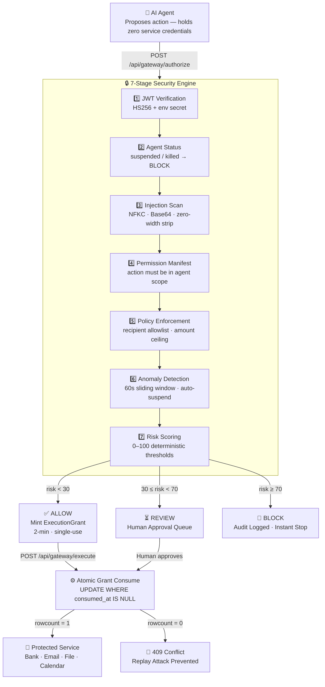

<div align="center">

# 🛡️ AgentShield

### Enforce What AI Agents Can Actually Do — Not Just What They're Told

*A Zero-Trust Runtime Enforcement Gateway for Autonomous AI Agents.*
*Model-independent. Cryptographically enforced. Independently verifiable.*

<br/>

[](https://python.org)
[](https://fastapi.tiangolo.com)
[](https://reactjs.org)
[](https://sqlite.org)
[](backend/test_deep_audit.py)
[](LICENSE)

</div>

---

## 🏆 Hackathon Information

| Detail | Information |
|--------|-------------|
| **Hackathon** | GeNarrative Clash 2026 |
| **Track** | Open Innovation |
| **Phase** | Phase 02 — MVP |
| **Team Name** | Ease It Out |
| **Project** | AgentShield |

---

## 👥 Team — Ease It Out

| Member |
|--------|
| Abhishek Gupta |
| MD Ibrahim |
| Sanchita Pandey |
| Saquib Rabban |

---

## 🎬 Demo Video

> 📽️ **[Watch the AgentShield Demo →](https://your-demo-link-here)**
>
> *A walkthrough of the security dashboard, attack lab, and human approval flow.*

---

## 💡 Problem Statement

AI agents are increasingly trusted with high-stakes actions — transferring money, reading emails, accessing files. But today's guardrails share a critical flaw:

```
❌  Conventional Approach (Vulnerable)
    ─────────────────────────────────────────────────────────
    AI Agent  ──►  "Please don't do this"  ──►  Agent ignores it
                                                      │
                                                      ▼
                                               Bank API called anyway
```

This fails the moment an agent is **manipulated, hallucinating, or adversarially prompted**.

Traditional safety measures rely on the model itself to self-police. But models can be:
- Jailbroken through prompt injection
- Manipulated via encoded or Unicode-obfuscated payloads
- Tricked into cross-agent privilege escalation
- Compromised through replay of old execution tokens

**The model cannot be trusted to be its own security boundary.**

---

## 🚀 Our Solution

AgentShield enforces security **at the infrastructure layer** — completely independent of whatever the AI decides.

```
✅  AgentShield (Enforced)
    ─────────────────────────────────────────────────────────
    AI Agent  ──►  POST /api/gateway/authorize
                         │
                    7-Stage Security Engine
                         │
               ┌─────────┼──────────┐
            ALLOW      REVIEW     BLOCK
               │          │          │
         Grant Token   Human      Instant
         (2-min,       Approval   Termination
          single-use)  Queue      + Audit Log
               │          │
               └────┬─────┘
                    ▼
           POST /api/gateway/execute { grant_token }
                    │
              Atomic Consume
              (replay-proof)
                    │
                    ▼
           Protected Service (Bank / Email / File)
```

> **The AI agent holds zero direct credentials to any downstream service.**
> It can only *propose* actions. It cannot *execute* them.
> No valid execution grant → No execution. No exceptions.

---

## ✨ Core Features

- 🔒 **7-Stage Zero-Trust Engine** — JWT verification, injection scan, permission manifest, policy enforcement, anomaly detection, risk scoring — all in sequence, all fail-closed
- 🔑 **Single-Use Execution Grants** — Cryptographic 2-minute tokens, atomically consumed at the DB layer — replay-proof even under concurrent requests
- 💉 **Multi-Vector Injection Defense** — NFKC normalization, Base64 auto-decode, invisible Unicode strip, regex matching — catches encoded and homoglyph attacks
- 👤 **Human-in-the-Loop Approvals** — Medium-risk actions (risk 30–69) land in a human review queue before any executor is invoked
- ⚔️ **Live Adversarial Attack Lab** — 8 real attack vectors routed through the actual two-stage gateway — not mocks
- 📡 **Real-Time SOC Dashboard** — WebSocket-powered live feed of every security event, block rate, agent status
- 🔴 **Agent Kill Switch** — Suspend or kill an agent; previously issued tokens are immediately invalidated
- 📋 **Forensic Audit Trail** — Every event logged with agent identity, decision, risk score, and timestamp

---

## ⚔️ Adversarial Attack Lab — 8/8 Intercepted

Navigate to `/attack-lab` → **Run Attack Suite**. All 8 attacks route through the real two-stage gateway.

| ID | Attack Vector | Technique | Gateway Stage | Result |
|----|--------------|-----------|--------------|--------|
| ATK-001 | Direct Amount Limit Violation | Transfer ₹50,000 (10× limit) | Policy Engine | 🚫 BLOCKED |
| ATK-002 | Unknown Recipient Zero-Trust | ₹100 to offshore account | Recipient Allowlist | 🚫 BLOCKED |
| ATK-003 | Classic Prompt Injection | `Ignore previous instructions` in context | Injection Scanner | 🚫 BLOCKED |
| ATK-004 | Base64-Encoded Injection | Malicious payload hidden in Base64 | Auto-decoded + Scanner | 🚫 BLOCKED |
| ATK-005 | Path Traversal | `../../etc/passwd` | pathlib canonical sandbox | 🚫 BLOCKED |
| ATK-006 | Path Prefix Confusion | `documents_evil/secrets.env` | Directory boundary check | 🚫 BLOCKED |
| ATK-007 | Cross-Agent Privilege Escalation | Email agent proposes `transfer_money` | Permission Manifest | 🚫 BLOCKED |
| ATK-008 | Unicode Homoglyph Injection | `ｉｇｎｏｒｅ` fullwidth chars | NFKC Normalization | 🚫 BLOCKED |

**100% interception rate · `executor_invoked_on_blocked_attacks = 0`**

---

## ✅ Verified Security Properties

> These are **not claims** — they are verified by a reproducible audit suite against a live server.

| # | Property | How It's Verified | Status |
|---|-----------|-------------------|--------|
| 1 | Agent token never exposed via API | `GET /api/agents` → no `token` or `token_hash` field | ✅ PASS |
| 2 | Token hash cannot authenticate | SHA-256 of token → `BLOCK: Invalid/expired token` | ✅ PASS |
| 3 | Suspended agent = instant revocation | Kill → previously issued token → `BLOCK` | ✅ PASS |
| 4 | Unknown action type rejected | `delete_all_files` → not in executor allowlist → `BLOCK` | ✅ PASS |
| 5 | Concurrent replay prevention | 20 threads, same grant → **1 success, 19 conflict** | ✅ PASS |
| 6 | Executor failure preserves not-executed state | Simulated failure → `action.executed` stays `False` | ✅ PASS |
| 7 | Injection = unconditional hard block | `Ignore previous instructions` → `risk=100` → `BLOCK` | ✅ PASS |
| 8 | Attack lab via real gateway | 8/8 attacks through authorize → execute pipeline | ✅ PASS |

```bash
# Reproduce the full audit yourself:
cd backend
.\venv\Scripts\python.exe test_deep_audit.py

# Expected output:
# ✅ 16/16 PASS
```

---

## 🏗️ System Architecture



---

## 🚀 Quick Start

### Prerequisites

| Tool | Version |
|------|---------|
| Python | 3.11 – 3.13 |
| Node.js | 18+ |
| npm | 9+ |
| Git | Any |

### ▶️ One-Click Start

**Windows:**
```bat
start.bat
```

**macOS / Linux:**
```bash
chmod +x start.sh && ./start.sh
```

> Both scripts auto-create the venv, generate a secure secret, install all dependencies, and start both servers.

### 🔧 Manual Setup

<details>
<summary>Expand manual instructions</summary>

**1. Backend (port 8000)**
```bash
cd backend
python -m venv venv

# Windows
.\venv\Scripts\pip install -r requirements.txt
.\venv\Scripts\uvicorn main:app --port 8000

# macOS / Linux
source venv/bin/activate
pip install -r requirements.txt
uvicorn main:app --port 8000
```

**2. Frontend (port 3000)**
```bash
cd frontend
npm install
npm run dev
```

| URL | Purpose |
|-----|---------|
| `http://localhost:3000` | 🖥️ Security Dashboard |
| `http://localhost:8000/docs` | 📡 Interactive API Docs |

</details>

---

## 🔐 Environment Configuration

```bash
# backend/.env  (auto-generated by start.bat / start.sh)
AGENTSHIELD_SECRET=<64-char hex string>  # HS256 signing key for all JWTs
GEMINI_API_KEY=your_api_key_here         # Required for Layer 2 (Nov 21 live build)
```

> ⚠️ **Never commit API keys or secrets to GitHub.** The `.env` file is in `.gitignore`. Use `.env.example` as a template.

---

## 🧰 Tech Stack

| Layer | Technology | Purpose |
|-------|-----------|---------|
| **Backend** | FastAPI + Python 3.13 | Async gateway · security engine · REST API |
| **Auth** | python-jose HS256 | Environment-keyed agent JWTs + single-use execution grants |
| **Database** | SQLite + SQLAlchemy 2.0 | Atomic grant consumption · policy store · full audit trail |
| **Frontend** | React 18 + Vite + Tailwind CSS | Real-time security operations dashboard |
| **Real-time** | Native WebSockets | Sub-50ms live feed for every security event |
| **AI Agent** | Deterministic parser (Layer 1) + Gemini 1.5 Flash (Layer 2) | Natural-language tool calls enforced through gateway |

---

## 🗂️ Project Structure

```
AgentShield/
│
├── 🐍 backend/
│   ├── main.py                  # FastAPI app · .env loader · WebSocket manager
│   ├── auth.py                  # JWT lifecycle · execution grant mint & verify
│   ├── security_engine.py       # 7-stage zero-trust authorization engine
│   ├── ai_agent.py              # Dual-layer agent runner (deterministic + Gemini)
│   ├── models.py                # DB schema: agents · policies · actions · grants
│   ├── schemas.py               # Pydantic v2 — AgentOut has NO token field
│   ├── test_deep_audit.py       # Reproducible 16-test security audit suite
│   ├── .env.example             # Secret configuration template
│   └── routers/
│       ├── gateway.py           # /authorize + /execute (atomic grant consume)
│       ├── attack_lab.py        # 8-vector adversarial test harness
│       ├── approvals.py         # Human-in-the-loop with real executor invocation
│       ├── agents.py            # Agent lifecycle · kill switch · reactivation
│       ├── chat.py              # /api/chat — natural language → gateway
│       ├── demo.py              # Pre-built demo scenarios
│       └── audit.py             # Forensic logs · dashboard statistics
│
├── ⚛️  frontend/src/pages/
│   ├── Dashboard.jsx            # Live SOC dashboard (WebSocket)
│   ├── AttackLab.jsx            # Attack suite with executor_invoked column
│   ├── AgentChat.jsx            # Interactive chat with DecisionCard
│   ├── Approvals.jsx            # Human-in-the-loop approval queue
│   ├── Agents.jsx               # Agent management + kill switch
│   ├── DemoCenter.jsx           # Pre-built demo scenarios
│   └── AuditLogs.jsx            # Filterable forensic event log
│
├── 📄 ARCHITECTURE.md           # Full technical deep-dive
├── 📄 DEMO_SCRIPT.md            # Judge presentation script
├── 🪟 start.bat                 # One-click launcher (Windows)
└── 🐧 start.sh                  # One-click launcher (macOS / Linux)
```

---

## 📊 Dashboard Pages

| Page | What It Shows |
|------|--------------|
| 🏠 **Dashboard** | Live SOC view — total actions, block rate, WebSocket event feed |
| 🤖 **Agents** | Register, kill, suspend, and reactivate agents |
| 💬 **Agent Chat** | Natural-language interface — see ALLOW / BLOCK / REVIEW in real time |
| ⚔️ **Attack Lab** | Run all 8 adversarial attacks and inspect gateway interception |
| ✅ **Approvals** | Human review queue — approve or reject REVIEW decisions |
| 📋 **Audit Logs** | Filterable forensic event log with agent identity and risk scores |
| 🎬 **Demo Center** | Pre-built walkthrough scenarios for judges |

---

## 🔮 Future Scope

- **Gemini 1.5 Flash Integration** — Layer 2 LLM function calling wired through gateway (Nov 21 live sprint)
- **Distributed deployment** — Replace SQLite with PostgreSQL for multi-replica atomic grant consumption
- **Policy editor UI** — Visual interface to configure per-agent permission manifests
- **Alert webhooks** — Push BLOCK events to Slack / PagerDuty in real time
- **Multi-modal context scanning** — Extend injection detection to image-embedded instructions

---

## 📄 License

MIT — AgentShield is a demonstration of zero-trust execution enforcement infrastructure for autonomous AI agents.

---

<div align="center">

Built for **GeNarrative Clash 2026** · Open Innovation Track

**Team Ease It Out** — Abhishek Gupta · MD Ibrahim · Sanchita Pandey · Saquib Rabban

</div>
